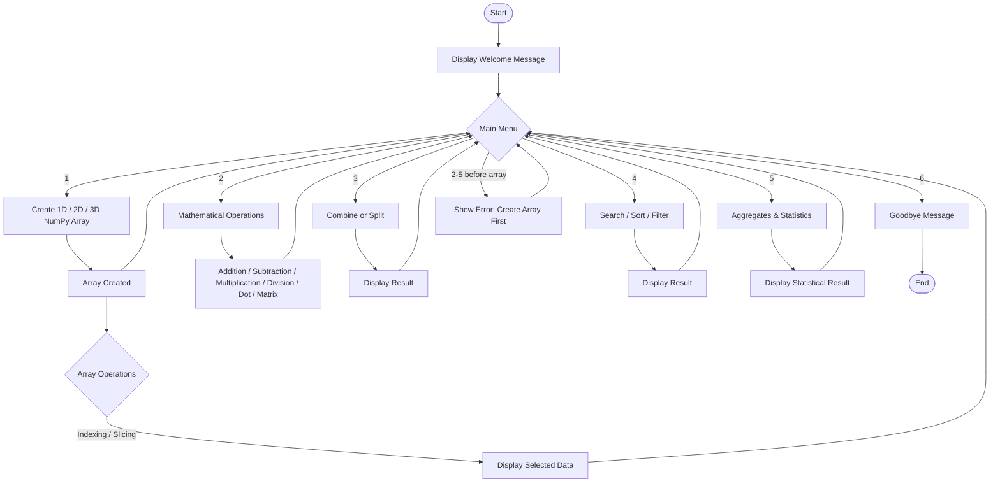

<div align="center">

<a href="https://github.com/">
  
</a>


A menu-driven Python project for creating, manipulating, analyzing, and processing NumPy arrays.

Python
NumPy
OOP

</div>

## 📌 About The Project

NumPy Analyzer is a console-based Python application built using NumPy and Object-Oriented Programming concepts. It allows users to create 1D, 2D, and 3D arrays and perform practical array operations through an easy menu-driven interface.

The project demonstrates core NumPy concepts such as indexing, slicing, mathematical operations, combining/splitting, searching, sorting, filtering, aggregation, statistics, and correlation.

────────

## 🎯 Objectives

• Learn practical NumPy array manipulation.
• Understand 1D, 2D, and 3D arrays.
• Implement indexing and slicing.
• Perform mathematical and matrix operations.
• Combine and split arrays.
• Search, sort, and filter values.
• Calculate statistical measures.
• Apply OOP concepts in a real Python project.
• Handle invalid input using exception handling.

────────

## 🚀 Features

|Option|Feature                  |Description                                                                           |
|------|-------------------------|--------------------------------------------------------------------------------------|
|1     |🧮 Create NumPy Array     |Create 1D, 2D or 3D arrays                                                            |
|2     |➕ Mathematical Operations|Addition, subtraction, multiplication, division, dot product and matrix multiplication|
|3     |🔗 Combine / Split        |Combine multiple arrays or split an array into parts                                  |
|4     |🔎 Search / Sort / Filter |Search values, sort arrays and filter values using conditions                         |
|5     |📊 Statistics             |Sum, mean, median, standard deviation, variance, min, max, percentile and correlation |
|6     |🚪 Exit                   |Close the application safely                                                          |

────────

## 🧠 Concepts Used

NumPy

• np.array()
• reshape()
• Indexing and slicing
• Broadcasting-compatible arithmetic
• np.sum()
• np.mean()
• np.median()
• np.std()
• np.var()
• np.min() / np.max()
• np.percentile()
• np.corrcoef()
• np.concatenate()
• np.array_split()
• np.sort()
• np.flip()
• np.argwhere()
• np.matmul()

## OOP Concepts Used

• Class – DataAnalytics
• Object – analyzer
• Constructor – __init__()
• Class variable – TITLE
• Class methods – show_welcome(), show_goodbye(), create_array()
• Static methods – input and helper methods
• Private attributes/methods – __array, __calculate(), __make_array(), etc.
• Encapsulation – array data and internal calculations are controlled through class methods.

────────

## 🔄 Program Flowchart



> 💡 GitHub renders Mermaid flowcharts automatically in supported Markdown views.

────────

## 💻 Demo Output

1️⃣ Welcome & Main Menu

Demo Output

Sample Console Output

```text
Welcome to the NumPy Analyzer!
========================================
Choose an option :
1. Create a Numpy Array
2. Perform Mathematical Operations
3. Combine or Split Arrays
4. Search, Sort, or Filter Arrays
5. Compute Aggregates and Statistics
6. Exit
```

Example: 2D Array Creation

```text
Select the type of array to create :
1. 1D Array
2. 2D Array
3. 3D Array

Enter your choice : 2
Enter the number of rows : 2
Enter the number of columns : 3
Enter 6 elements for the array separated by space : 1 2 3 4 5 6

Array created successfully :
[[1 2 3]
 [4 5 6]]
```

Example: Statistics

```text
Choose an aggregate/statistical operation :
1. Sum
2. Mean
3. Median
4. Standard Deviation
5. Variance
6. Minimum
7. Maximum
8. Percentile
9. Correlation Coefficient
```

────────

## 🎥 Video Demo

▶️ Project demonstration video:

> Replace the link below with your GitHub/Google Drive/YouTube demo video.

🎬 Watch NumPy Analyzer Demo

────────

## 🧪 Input Validation & Error Handling

The program handles common invalid inputs such as:

• Invalid menu choices
• Non-numeric values
• Incorrect number of array elements
• Zero or negative dimensions
• Division by zero
• Invalid slicing ranges
• Invalid number of split parts
• Mathematical operations before creating an array
• Invalid percentile values

Errors are caught and displayed without unnecessarily terminating the program.

────────

## 🌟 Why This Project Is Useful

This project combines NumPy + OOP + exception handling + menu-driven programming in one practical application. It is useful for understanding how numerical data can be created, transformed, searched, filtered, and statistically analyzed using Python.

────────

## 👩‍💻 Author

Khushi Chaudhary

> Python • NumPy • OOP • Data Analysis

────────

<div align="center">

✨ Made with Python & NumPy ✨


</div>
